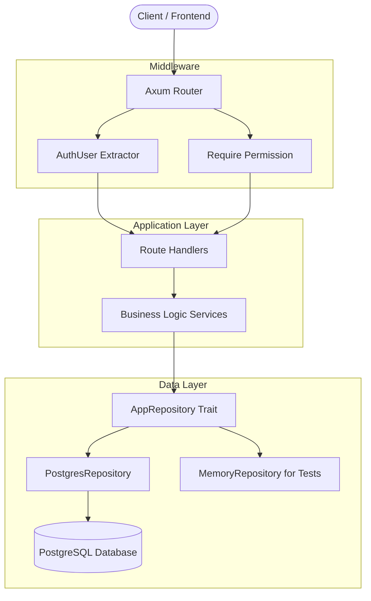

# Rust-Major-project
# 🛡️ Identity & Access Management (IAM) Platform


> A production-grade, multi-tenant Identity and Access Management (IAM) backend engineered in Rust. Designed to provide secure authentication, granular Role-Based Access Control (RBAC), and centralized tenant routing for downstream enterprise services.

---

## 1. System Overview
This project is a production-grade Identity and Access Management (IAM) backend platform. It is designed to handle core authentication, authorization, and tenant routing by managing Users, Organizations, Roles, and Permissions. The system acts as a centralized gatekeeper to securely answer who a user is, what organization they belong to, and what actions they are permitted to perform.

--- 

## 2. Technical Stack
The platform is built with a focus on performance, safety, and maintainability using the following technologies:
* **Language:** Rust
* **Web Framework:** Axum
* **Database:** PostgreSQL
* **Database Driver / Migrations:** SQLx
* **Authentication:** JWT (JSON Web Tokens) with Argon2 password hashing

---

## 3. Core Features
The system implements robust enterprise-level access controls:
* **Authentication & Session Management:** Secure user registration, login, and refresh token flows with session tracking and revocation.
* **Role-Based Access Control (RBAC):** Granular permission evaluation tied to custom roles within specific organizations.
* **Organization Management:** Multi-tenant architecture allowing users to hold different roles across different organizations.
* **API Key Infrastructure:** Generation and secure hashed storage of scoped API keys for programmatic access.
* **Audit Logging:** Immutable tracking of critical system actions (e.g., role creation, member addition) for accountability.

---

## 4. Setup & Installation
To run this project locally, ensure you have Rust and a PostgreSQL instance running.


```bash
cargo install sqlx-cli --no-default-features --features rustls,postgres
```
```bash
git clone <your-repository-url>
cd iam-platform
cp .env.example .env
```
```bash
sqlx database create
sqlx migrate run
```
```bash
cargo run
cargo test
cargo test --test integration_tests
```
----

## 5. Testing Strategy
The platform ensures reliability through a dual-layered testing approach utilizing the Repository Pattern:
* **Unit Tests:** Validates core cryptography, JWT lifecycles, and pagination mathematics in isolation.
* **Integration Tests:** Utilizes a custom `MemoryRepository` alongside the `tower` crate's `.oneshot()` method to simulate end-to-end HTTP request flows (like user registration) without requiring a live database connection. Run the test suite using:
  `cargo test`
--- 


## 6.  📂 Project Structure

The codebase strictly adheres to a decoupled, layered architecture to guarantee separation of concerns.

```text
.
├── migrations/             # SQLx database schema & seed data
├── src/
│   ├── config.rs           # Environment & state configuration
│   ├── main.rs             # Application entry point & TCP binding
│   ├── routes.rs           # Axum router & middleware orchestration
│   ├── handlers/           # HTTP transport layer (Controllers)
│   ├── middleware/         # Strongly-typed Auth Extractors & RBAC guards
│   ├── services/           # Core business logic & domain rules
│   ├── repositories/       # Data access abstraction (Postgres & Memory)
│   ├── models/             # Database entity representations
│   └── dto/                # Request validation & Response payloads
└── tests/
    ├── unit_tests.rs       # Isolated cryptography & pure function tests
    └── integration_tests.rs# End-to-end HTTP request flows (Memory DB)
```
---

## 7. Architecture Diagram
The platform follows a layered, decoupled architecture to ensure clear separation of concerns and maintainability.



---

## 🧠 What I Have Learnt

* **Advanced Trait Abstraction:** Mastered Rust's ownership model and dynamic dispatch (`Arc<dyn AppRepository>`), advancing beyond traditional manual memory management to safely swap database implementations.
* **Stateful Async Orchestration:** Safely shared thread-safe application state across concurrent tasks using Axum, eliminating data races.
* **Type-Driven Security:** Enforced authorization at the compiler level via the `FromRequestParts` trait, rejecting invalid HTTP requests before execution.
* **Strategic Systems Engineering:** Architected a decoupled, production-ready backend that scales, demonstrating the strict engineering standards required for high-impact enterprise environments.


